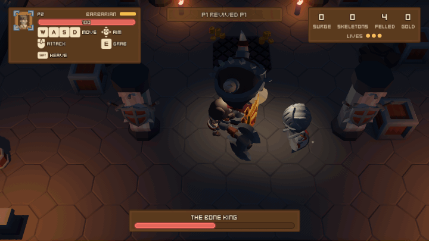
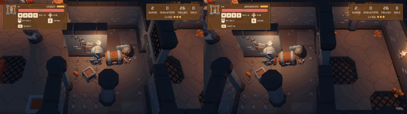
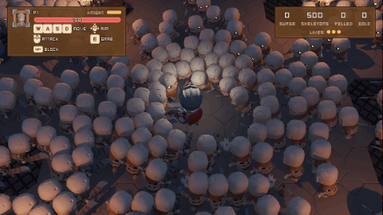
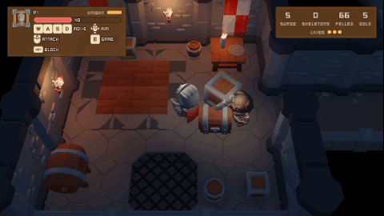
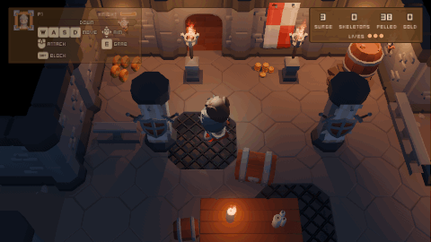
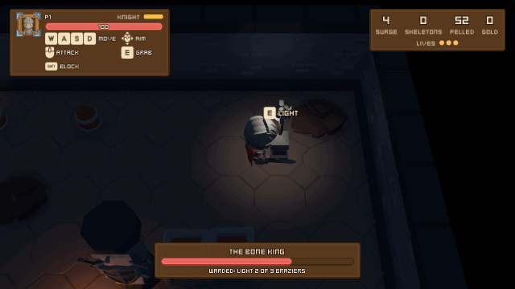
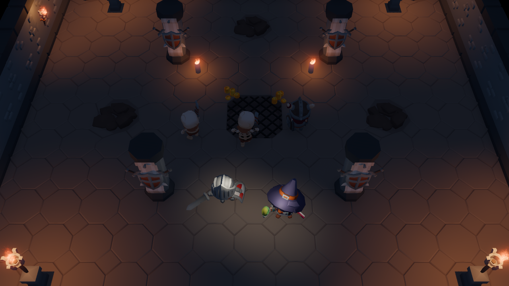
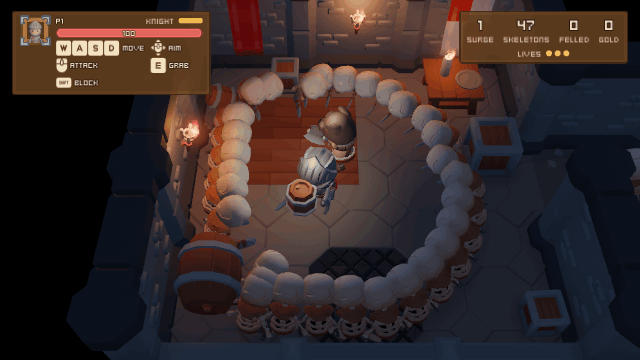

# Crypt Crew

[](https://github.com/FylmTM/godot-unified-demo/actions/workflows/ci.yml?query=branch%3Amain+event%3Apush)

**A co-op dungeon crawler for 1–4 players, on one couch or online, with rollback netcode, physics included.**

Up to four heroes fight down a crypt full of skeletons, haul its hoard to the lift and break the Bone King's ward
together. It is the demo game of [unified](https://github.com/FylmTM/godot-unified): the rules are one deterministic
simulation in Odin, and Godot draws it, plays its sound and runs its menus.



## Try it

You need git, curl and a C toolchain for Odin's linker (clang, or Visual Studio Build Tools on Windows). The first
`./uni` downloads the pinned Odin, and each command fetches what else it needs (Godot, Box3D).

```sh
git clone --recursive https://github.com/FylmTM/godot-unified-demo
cd godot-unified-demo
./uni run                            # play it
./uni run -- --host-port 7777        # host a game on the LAN...
./uni run -- --join 127.0.0.1:7777   # ...and join it from a second window
```

On Windows, run `uni.cmd` instead of `./uni`. Controls, couch co-op, saves and online play:
[`docs/playing.md`](docs/playing.md).

## Co-op on a bad link



*Both players' screens over one session, played with 150 ms of lag on each side (about 300 ms each way), jitter and 1%
loss (a 580 ms round trip). On a
run of this play (`./uni coop --lan -- --play=haul --lag 150`) the joiner rolled back 1,001 times, 13 ticks deep on
average, and re-simulated 13,754 ticks, with no desync.*

Every player runs the whole game and only input crosses the network. An event plays the moment it is predicted, but
what must be final waits: a coin vanishes at once, and the purse counts it only once the pickup is confirmed
([`purse.gd`](game/play/purse.gd)).

```gdscript
func on_pickup(state: UnifiedSession.EventState, gold: int, value: int, at: Vector3) -> void:
	if state != UnifiedSession.EVENT_CONFIRMED:
		return
	if _session.mode != UnifiedSession.MODE_REPLAY:
		_show(gold)
	if Engine.get_process_frames() != _chimed_frame:
		_chimed_frame = Engine.get_process_frames()
		Sfx.play(&"coin")
	_rise(at, value)
```

## 500 skeletons, one MultiMesh



The skeletons are one MultiMesh of a baked minion: hundreds cost one draw call a pass and no node each. Each frame the
extension writes an instance per minion from the state, its clip and when it started; the shader skins it from a
texture of baked bones. A rollback, a pause or a replay seek shows exactly the pose the state says (the bake:
[`docs/ART.md`](docs/ART.md#crowds)).

```odin
minion_instance :: proc(minion: ^g.Minion, handle: sim.Handle(g.Minion)) -> godot.Multi_View_Item(MultiView) {
	clip: Minion_Clip
	switch minion.phase {
	// ... Rise, Idle, Chase, Attack, Dying: the clip each plays
	}
	key := sim.handle_key(handle)
	start := f32(minion.since)
	if clip == .Idle || clip == .Walk {
		start = -f32(key % MINION_PHASE_KEYS) * MINION_PHASE_S * g.TICK_HZ
	}
	struck := f32(minion.struck) if minion.struck != 0 else MINION_NEVER_STRUCK
	return {
		key    = key,
		kind   = .Minion,
		pos    = sim.Position(minion.pos),
		rot    = dmath.quat_yaw(minion.facing),
		custom = {f32(clip), start, struck, 0},
	}
}
```

## Physics inside the rollback





Box3D bodies, joints, characters and ragdolls, saved, restored and re-simulated with the rest of the state:
[`hoard.odin`](simulation/crypt_crew/hoard.odin), [`lift.odin`](simulation/crypt_crew/lift.odin),
[`traps.odin`](simulation/crypt_crew/traps.odin), [`ragdolls.odin`](simulation/crypt_crew/ragdolls.odin),
[`barbarian.odin`](simulation/crypt_crew/barbarian.odin).

## The Bone King



At two thirds and one third of its health the King roars, every brazier goes out, and no blow hurts it until the
party lights enough of them again ([`boss.odin`](simulation/crypt_crew/boss.odin),
[`braziers.odin`](simulation/crypt_crew/braziers.odin)).



## How the rules look

**All of the game's state is one block of plain data.** No pointers, so a rollback is a copy and the bytes are the
checksum ([`state.odin`](simulation/crypt_crew/state.odin)).

```odin
State :: struct {
	clock:        sim.Clock, // game time and the co-op pause (pause.odin): the harness advances it unless paused
	players:      sim.Players(Hero, Profile, Input, PLAYERS),
	minions:      sim.Table(Minion, MAX_MINIONS), // the skeletons, rows with no body (minions.odin)
	// ...
	hoard:        Hoard, // the floor's gold chest
	lift:         Lift, // the floor's exit
	// ...
	boss:         Boss,
	_pad_boss:    [4]u8,
}
```
**A rule is a pure proc over it.** The tick asks `revive_target` whom a hero tends, and the view asks the same proc
whether to show "[E] Revive", so the prompt shows exactly when a press would revive
([`revive.odin`](simulation/crypt_crew/revive.odin)).

```odin
revive_target :: proc(players: ^Heroes, player: sim.Player) -> (target: sim.Player) {
	if !sim.player_present(players, player) do return
	reviver := sim.player_data(players, player)
	if reviver.held != {} || (reviver.action != .None && reviver.action != .Attack && reviver.action != .Revive) do return
	nearest := REVIVE_RANGE * REVIVE_RANGE
	heroes := sim.iterate_present(players)
	for hero, other in sim.next(&heroes) {
		if other == player || hero.action != .Down || hero.heave != .None do continue
		apart := dmath.length_sq(hero.pos.xz - reviver.pos.xz)
		if apart <= nearest && (target == {} || apart < nearest) do target, nearest = other, apart
	}
	return
}
```

Every rule, in tick order: [`docs/rules.md`](docs/rules.md). Each of unified's features as the game uses it, with its
files: [`docs/unified.md`](docs/unified.md).

## Tested like this



*This clip is a test: a recorded two-player LAN session that `./uni test` replays and holds to every beat.*

- **Rules under rollback**: each rule test rolls back over every step it takes.
- **Sessions that agree**: rollback every tick, churn, a bad network and late joins, checksummed as they play.
- **The same bits everywhere**: reference runs on Windows, Linux and macOS, x64 and ARM64.
- **Recorded play**: two-player sessions and an F3 note replayed as regressions; bots play a whole run.
- **The real game**: imported, walked through its menus and played by an agent with `uni drive`.

Every layer, its command and its files: [`docs/testing.md`](docs/testing.md).

## Layout

| Path | What it is |
|---|---|
| [`simulation/crypt_crew/`](simulation/crypt_crew/) | The rules: the deterministic simulation, one system per file |
| [`simulation/extension/`](simulation/extension/) | The GDExtension: the sim inside Godot, its state turned into views (the view contract: `./uni doc`) |
| [`simulation/headless/`](simulation/headless/) | The sim without Godot: sync-tests, replays, sessions, benchmarks |
| [`simulation/tests/`](simulation/tests/) | Every test of the sim, the recorded replays among them |
| [`game/`](game/) | The Godot side (the project is the repo root): menus, HUD, views, effects, levels |
| [`tools/`](tools/), `unified/` | This game's `uni` commands; unified, as a git submodule |

## Builds

`./uni release` makes a playable zip for this machine (macOS arm64 or Windows x64): exported, version-stamped and
smoke-tested; `--no-eos` leaves online play out. CI builds and plays both on every push to `main`.

## Benchmarks

`./uni bench`; each platform's numbers are in the summary of the [latest push run on `main`](https://github.com/FylmTM/godot-unified-demo/actions/workflows/ci.yml?query=branch%3Amain+event%3Apush).

## License

The code is licensed under either of [Apache License 2.0](LICENSE-APACHE) or [MIT license](LICENSE-MIT), at your
option. Art, sound and music keep their own licences (all CC0), listed with their sources in [`CREDITS.md`](CREDITS.md).

Unless you explicitly state otherwise, any contribution intentionally submitted for inclusion in the work by you, as
defined in the Apache-2.0 license, shall be dual licensed as above, without any additional terms or conditions.
